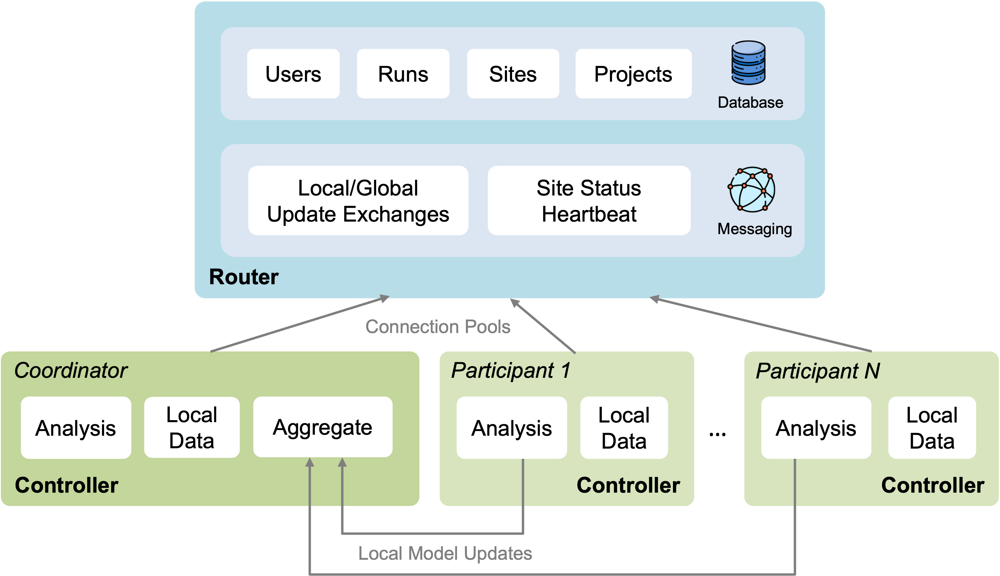

# Introduction

The testbed joins lab computers into federated runs. A main device runs the router, every lab computer that trains runs a site, and one site coordinates. This page explains how a run works and who does what, and [Quick Installation](quick-installation.md) then installs a site.

## How a run works

The admin of the main device creates a project for a set of enrolled sites and starts a run. A run lasts a fixed number of rounds, and each round takes the same steps.

1. Each site downloads the current global model and trains it for a few local epochs on its own sample store.
2. Each site uploads its weight update to the router. The update holds only the change to the model's weights.
3. The coordinator downloads the updates and averages them, weighting each site by its number of training samples.
4. The evaluation gate scores the averaged model and the current one on the coordinator's held-out test set. By default it keeps the new model only when its mean relative l2 error stays at or below the current model's.
5. A kept model becomes the global model of the next round. It also enters the model registry, where it waits for the coordinator to sign it off.

A site's log names the state of its run at each step. A round passes through Standby, Preparing, Running, Pending Success, Pending Aggregating and Aggregating, and the next round starts again at Standby. After the last round the run ends in Success, or in Failed when a step fails.

<figure markdown="span">
  { width="640" }
  <figcaption>The router of Starfish-FL and the controllers of its sites. starfish-site runs the controller's code natively on a lab computer.</figcaption>
</figure>

## Who does what

| Role | Work |
| --- | --- |
| Practitioner | Installs starfish-site on a lab computer, keeps the lab's sample store and runs the site during a run |
| Admin | Runs the main device, gives each site an enrolment code, creates projects and starts runs |
| Coordinator | A practitioner whose site holds the held-out test set and who signs off the models the gate keeps |

## Where to go next

Practitioners continue with [Quick Installation](quick-installation.md) and [First Run](first-run.md). Admins start with [Main Device](../main-device/introduction.md) and can rehearse a whole run with [A Federated Run on Synthetic Stores](../tutorials/synthetic-run.md).
